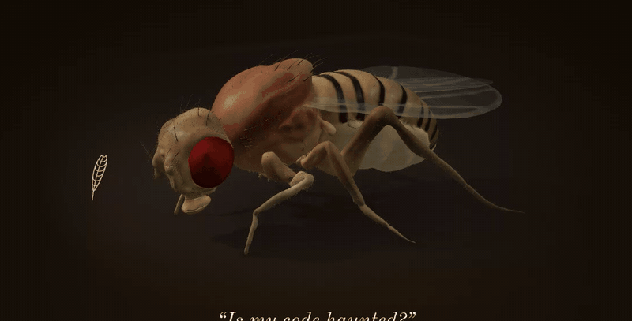

# Fly Séance

**A séance with a simulated fruit-fly brain.** You ask a question. A local Gemma
model, the medium, turns it into an offering — nectar, a bitter herb, a touch or a
breath on the antenna — and may lift the veil, silencing three inhibitory neurons. The wiring diagram of a real fly brain (the FlyWire connectome, 127,400
neurons in the 630 release) is simulated, and the fly's body answers: it reaches for the nectar, it
grooms the touch away, or it stays still. The medium then speaks for it.

Everything runs on your own machine. No cloud model, no API key.



> The fly does not understand your question. What is real is how its simulated
> body responds to the offering, computed from the wiring of an actual fly.
> See [docs/SCIENCE.md](docs/SCIENCE.md).

## Between questions

The fly is never animated at random. Every 15–40 s, while no one is asking, the
room sends the real brain one small stimulus drawn at random (a speck of sugar, a
draught on the antenna, a bitter crumb, a breath) and the connectome alone decides
whether the body moves. Most draws do nothing; some make it feed or groom.

## Questions the spirits refuse

Someone may ask a real question. Health, self-harm, legal and money questions are
not put to the fly: the page says so and points elsewhere (for self-harm, to
[findahelpline.com](https://findahelpline.com/), free helplines in 130+ countries).
Self-harm is caught by a plain pattern in code before the model is even asked.
Behind the veil, the fly's stillness is shown as silence rather than a "no".

The fly answers with its body, so it can only say yes, no, or nothing. A question
that asks for a name, a place or a reason ("Who will I marry?") is turned away with
a request for a yes-or-no question: questions starting with who, what, why, how...
are caught in code, subtler ones ("Paris or Lyon?") by the medium.

Some questions stir nothing in the medium ("Are tabs better than spaces?"): Gemma
offers nothing at all. Code then touches the antenna and the fly brushes the question
off, which is as good an answer as any.

## How it works

1. **Consecrate** — Gemma reads the question and returns an offering as strict JSON
   (a rate in Hz for each sensory group), validated and clamped in code.
2. **Channel** — a leaky integrate-and-fire model of the whole fly brain
   (Shiu et al., *Nature* 2024) is driven by that offering for one simulated second,
   over several trials.
3. **Read** — code, not the model, reads the motor response: MN9 fires → the fly
   feeds (*yes*); aBN1 and the antennal descending neurons fire → it grooms (*it
   brushes the question off*); neither → stillness (*no*).
4. **Speak** — Gemma voices the answer, given the question, the offering and the verdict.

Details: [docs/ARCHITECTURE.md](docs/ARCHITECTURE.md).

## Run it

```bash
uv venv && source .venv/bin/activate && uv pip install -e ".[dev]"
python scripts/fetch_connectome.py     # ~90 MB, checksummed, into data/
ollama pull gemma4:e4b-it-q4_K_M       # the medium
python -m fly_seance.seance "Will my book be a success?"   # one séance in the terminal
python -m fly_seance.server            # the séance page: http://127.0.0.1:8630
```

## Status

- [x] Connectome model with competing offerings (`brain.py`), one process per trial (`worker.py`)
- [x] Oracle: offering validation, parallel trials, verdict (`oracle.py`), calibrated thresholds
- [x] Medium: Gemma via Ollama (`medium.py`), command-line séance (`seance.py`)
- [x] Séance page: SSE ritual, live spike raster, rates against thresholds (`server.py`, `web/`)
- [x] The fly in 3D, driven by the read-out neurons (`web/fly/`): the proboscis follows MN9, the forelegs
      groom with aBN1/DN1/DN2, and nothing
      moves unless a neuron crosses its threshold

## How it was built

With AI agents, under the author's direction. Claude Code wrote most of the code,
tests and docs; OpenAI Codex produced the rig, the conversion script and the animation
module of the 3D fly (`web/fly/`). Commits from `30ebe9e` on carry a Co-Authored-By
line; the two first commits don't, but were made the same way. Every measured number
in these docs comes from running this code.

## Credits

Built on the model of Shiu et al. (2024, MIT) and the FlyWire connectome
(Dorkenwald et al. 2024; Schlegel et al. 2024). The 3D fly is based on
["Wildtype Female Drosophila Melanogaster"](https://sketchfab.com/3d-models/wildtype-female-drosophila-melanogaster-3ba1adba62f34fe995413ee5e9cf3c25)
by [mlykouretzos](https://sketchfab.com/mlykouretzos), CC BY 4.0, modified (decimated,
segmented, rigged, recoloured); see [web/fly/RIG.md](web/fly/RIG.md). See [NOTICE.md](NOTICE.md).

## License

MIT — see [LICENSE](LICENSE).
